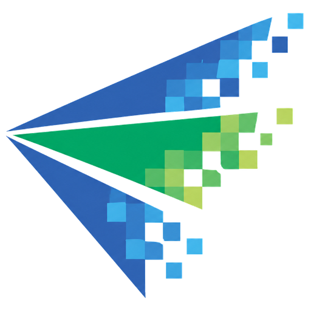
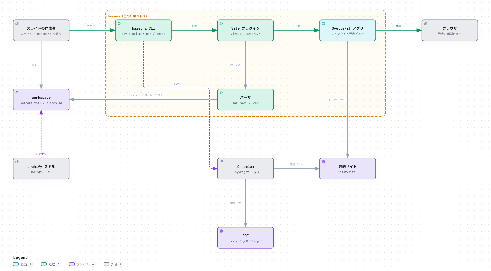
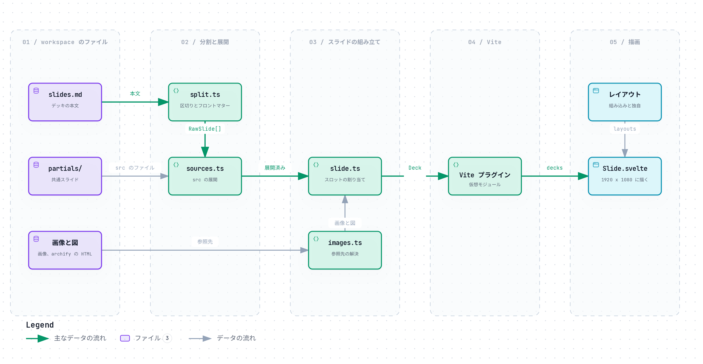

# kazeori



kazeori（風織り）は、カザモリスタイルのスライドを markdown から生成するツールです。
カザモリスタイルは、カザモリ合同会社のスライドテンプレートから書き起こした配色、レイアウト、装飾のことです。
内容は Slidev とほぼ同じ書式の markdown で書き、ブラウザでの発表と PDF の出力に使います。

ツールは特定の会社に依存しません。
ロゴ、社名、copyright 表記は含めず、利用者が workspace の設定から渡します。

## 必要なもの

- [bun](https://bun.sh/) 1.4 以降
- PDF を出力する場合は Chromium（`bunx playwright install chromium` でインストールできます）

## 最小構成で始める

空の `kazeori.yaml` を置いたディレクトリがあれば、スライドを作れます。
次の例では、kazeori のリポジトリを `~/kazeori` に clone したものとします。

```sh
git clone git@github.com:kazamori/kazeori.git ~/kazeori
cd ~/kazeori && bun install

mkdir ~/my-slides && cd ~/my-slides
touch kazeori.yaml
bun ~/kazeori/cli/main.ts new hello --template talk --title "はじめてのスライド"
bun ~/kazeori/cli/main.ts dev
```

`new` は `decks/<年>/<日付>-hello/slides.md` を作ります。
`dev` で開いたページでデッキを選ぶと、編集しながらプレビューできます。
PDF は `bun ~/kazeori/cli/main.ts pdf --deck hello` で `dist/` に出力します。

この構成では、ロゴ、社名、フッターのないスライドになります。
ロゴや社名を入れるときは、`kazeori.yaml` に `brand:` を書きます（後述の「kazeori.yaml」）。
雛形、共通スライド、独自レイアウトも、必要になったときに同じディレクトリへ足していけます。

`kazeori.yaml` がどこにもないディレクトリで実行すると、kazeori に同梱のサンプル（`examples/`）を workspace として使います。
試すには便利ですが、`new` で作ったデッキが kazeori のリポジトリの中にできるので、普段の利用には向きません。

## workspace

kazeori は、`kazeori.yaml` を置いたディレクトリを workspace として扱います。
デッキ、ロゴ、雛形、共通スライド、独自レイアウトは workspace に置きます。

```
my-decks/
├── package.json
├── kazeori.yaml       # ブランド設定、既定値、ディレクトリの場所
├── brand/             # ロゴ
├── templates/         # デッキの雛形
├── partials/          # 共通スライド
├── layouts/           # 独自レイアウト（Svelte コンポーネント）
├── decks/
│   └── 2026/
│       └── 2026-10-17-sample/
│           ├── slides.md
│           ├── images/
│           └── diagrams/   # archify の図
└── dist/              # 生成物（PDF、静的サイト）
```

kazeori はカレントディレクトリから親へ `kazeori.yaml` を探します。
見つからないときは、このリポジトリの `examples/`（ロゴのないサンプル workspace）を使います。

workspace の `package.json` には、kazeori を git の依存として追加します。

```json
{
	"private": true,
	"devDependencies": {
		"kazeori": "git+ssh://git@github.com/kazamori/kazeori.git#<タグ>"
	}
}
```

`bun install` のあとは `bunx kazeori <コマンド>` で使えます。
kazeori 自体を修正しながら試すときは、kazeori のリポジトリで `bun link` を実行し、workspace 側で `bun link kazeori` を実行します。

### kazeori.yaml

```yaml
brand:
  name: Example Inc.
  copyright: '© {year} {name}'
  logo:
    blue: ./brand/logo-blue.png
    green: ./brand/logo-green.png
    white: ./brand/logo-white.svg

defaults:
  color: blue
  author: 山田 太郎

paths:
  decks: ./decks
  templates: ./templates
  partials: ./partials
  layouts: ./layouts
  dist: ./dist
```

`brand` の項目は次のとおりです。

- **name**：社名や個人名です。ロゴがないときは、表紙と締めのスライドにこの名前を文字で表示します。
- **copyright**：フッターの表記です。`{year}` はデッキの日付の年（日付がなければ今年）に、`{name}` は `name` に置き換えます。省略するとフッターを表示しません。
- **logo**：配色ごとのロゴ（`blue`、`green`）と、accent 色の背景に置く白抜きロゴ（`white`）です。1 つのファイルを使い回すなら、文字列で指定できます。パスは `kazeori.yaml` からの相対パスです。

ブランド設定は、kazeori.yaml、CLI の `--brand <file>`、デッキの headmatter の `brand:` の順に上書きされます。
ブランド設定がなくても、ロゴと copyright のないカザモリスタイルのスライドとして描画できます。

`paths` はすべて省略でき、省略時は上の例の場所を使います。

## コマンド

| コマンド                                                                                         | 動作                                                                                                                        |
| ------------------------------------------------------------------------------------------------ | --------------------------------------------------------------------------------------------------------------------------- |
| `kazeori dev [--port <n>] [--open]`                                                              | dev server を起動します。markdown、共通スライド、独自レイアウト、画像、archify の図を保存すると、ブラウザを再読み込みします |
| `kazeori build [--deck <id>...] [--out <dir>]`                                                   | 静的サイトを出力します。既定の出力先は `dist/site/` です                                                                    |
| `kazeori pdf (--deck <id>... \| --year <yyyy> \| --all) [--out <dir>] [--strict]`                | PDF を出力します。既定の出力先は `dist/<デッキ ID>.pdf` です                                                                |
| `kazeori check [--deck <id>...] [--json] [--verbose]`                                            | ビルドせずにデッキを検査します                                                                                              |
| `kazeori list [--year <yyyy>] [--json]`                                                          | デッキの一覧を表示します                                                                                                    |
| `kazeori new <name> [--template <name>] [--date <yyyy-mm-dd>] [--title <text>] [--event <text>]` | 雛形から `decks/<年>/<日付>-<name>/slides.md` を作ります                                                                    |
| `kazeori templates [--json]`                                                                     | 使える雛形の一覧を表示します                                                                                                |

すべてのコマンドで `--workspace <dir>`（kazeori.yaml を探し始めるディレクトリ）と `--brand <file>`（ブランド設定の上書き）を指定できます。

`--deck` には、デッキ ID（`decks/` からの相対パス、例 `2026/2026-10-17-sample`）、ディレクトリ名（`2026-10-17-sample`）、日付を除いた名前（`sample`）のどれでも指定できます。
名前が複数のデッキに一致するときはエラーになります。

終了コードは次のとおりです。

- **0**：成功
- **1**：デッキの不備（`check` のエラー、未知のデッキや雛形、`--strict` を付けたときの文字のはみ出し）
- **2**：実行環境の問題（Chromium がない、ポートが使えないなど）

`build` と `pdf` は、最初に `check` と同じ検査を行い、エラーがあれば出力しません。
`pdf` は出力前に、スライドの枠から文字がはみ出していないかも調べて警告します。
dev server では、はみ出した枠に赤い線を引きます。

## 発表ビュー

`kazeori dev` で開いたページ、または `kazeori build` で出力したサイトで、デッキを選ぶと発表ビューになります。

- `→`、`↓`、`Space`、`PageDown`、`Enter`、マウスのクリック：次のスライド（リンクのクリックや文字の選択では進みません）
- `←`、`↑`、`PageUp`、`Backspace`：前のスライド
- `Home`、`End`：最初と最後のスライド
- `f`：全画面の切り替え
- `o`：一覧表示の切り替え

markdown で書いた外部の URL（`http://`、`https://`）へのリンクは、発表中のデッキから離れないように、ブラウザの別のタブで開きます。
`<a>` を直接書いた場合は書いたとおりに描くので、別のタブで開くには `target="_blank"` を自分で付けてください。

表示中のスライドの番号は URL の末尾（`#3`）に入るので、再読み込みしても同じスライドを表示します。

## markdown の書式

Slidev の利用者がそのまま書けるよう、kazeori の機能と競合しない限り Slidev の書式に合わせています。

```markdown
---
title: kazeori のご紹介
themeConfig:
  color: blue
author: 山田 太郎
event: サンプル勉強会
date: 2026-10-17
---

## 表紙のサブタイトル

---

layout: features
title: Featured List
titleAccent: Slides
---

## サブタイトル

導入文。

- ### 項目 1
  説明
- ### 項目 2
  説明

<!--
発表者のノート。スライドには表示しません。
-->
```

- `---` の行でスライドを区切ります。区切りの直後の行が空行でなければ、次の `---` までをそのスライドのフロントマターとして読みます。コードブロックの中の `---` では区切りません。
- ファイル先頭のフロントマター（headmatter）は、デッキ全体の設定であると同時に 1 枚目のスライドのフロントマターです。1 枚目の既定のレイアウトは `cover`、2 枚目以降は `default` です。
- スライドの先頭に置いた ` ```yaml ` のブロックもフロントマターとして扱います。
- スライド末尾の HTML コメントは、発表者のノートとして扱い、スライドにも PDF にも表示しません。

### headmatter の項目

| 項目                | 意味                                                                           |
| ------------------- | ------------------------------------------------------------------------------ |
| `title`             | デッキの題名。表紙のタイトルにも使います                                       |
| `author`            | 発表者                                                                         |
| `themeConfig.color` | 配色（`blue` または `green`）。省略時は kazeori.yaml の `defaults.color`       |
| `event`             | イベント名（kazeori 独自）                                                     |
| `date`              | 日付（`YYYY-MM-DD`、kazeori 独自）。表紙には「2026年10月17日」の形で表示します |
| `brand`             | ブランド設定の上書き（kazeori 独自）                                           |

値に `#` や `: ` を含めるときは、YAML の規則に従って引用符で囲んでください（`event: "Kyoto.go #50"`）。
囲まないと、`#` 以降はコメントとして無視されます。

### スライドの項目

| 項目               | 意味                                               |
| ------------------ | -------------------------------------------------- |
| `layout`           | レイアウト                                         |
| `title`            | タイトルの 1 行目                                  |
| `titleAccent`      | accent 色で描くタイトルの 2 行目（kazeori 独自）   |
| `class`            | スライドに追加する CSS クラス                      |
| `hide`、`disabled` | `true` ならスライドを出力しません                  |
| `src`              | 別ファイルのスライドを読み込みます（共通スライド） |
| `image`            | 画像（`image-left` などで使います）                |
| `current` | `agenda` で強調する項目の番号（kazeori 独自） |
| `columns` | `feature-grid` の列数（1〜4、kazeori 独自） |

フロントマターに `title` がないときは、本文の最初の `#` 見出しをタイトルとして使います。
タイトル（`title`、`titleAccent`、本文の最初の `#` 見出し）とサブタイトルは、`<br>` の位置で改行します。
YAML の複数行の文字列（`title: |`）の改行も、そのまま改行になります。
日本語の長いタイトルを語の切れ目で折り返したいときに使ってください。

```markdown
---
title: 人に見せる図、<br>自分が分かるための図
---
```

タイトル、サブタイトル、headmatter の `event` には、インラインの markdown を書けます。
リンク、太字、斜体、インラインのコードを使えるほか、本文と同じく `<a>` などの HTML も直接書けます。
ブラウザのタブの題名やデッキ一覧には、書式を除いた文字列を表示します。
`[` や `*` で始まる値は YAML の規則に従って引用符で囲んでください。

```markdown
---
title: "[archify](https://github.com/tt-a1i/archify) の紹介"
event: はんなりPython LT **#1**
---
```
本文の構造は、次の規則でレイアウトの各部分に割り当てます。

- **サブタイトル**：本文の最初の `##` 見出し
- **項目**：最初の箇条書きの各要素。要素の中の見出しが項目名、画像が項目の画像、残りが説明になります。
- **画像**：画像だけの段落。拡張子が `.html` のものは archify の図として扱います。
- **スロット**：`::right::` などの行で区切った部分（`two-cols` で使います）

レイアウトが描かない画像（`center` に置いた画像や、枚数の上限を超えた画像など）と、本文中に書いた模様や archify の図は、`check` で警告します。

### 画像のキャプション

画像のタイトル（`"…"` の部分）が、図の下に添えるキャプションになります。
archify の図（`.html`）にも同じ書式で付けられます。
キャプションの分だけ図を縮めて、図とキャプションを枠に収めます。

```markdown

```

代替テキスト（`[…]` の部分）は、図を読めない読み手のための説明として残ります。
全面の画像（`image`）ではキャプションを画像の右下に重ね、段の中や本文中の画像では画像の下に添えます。
Slidev で開くと、タイトルは画像の `title` 属性になるだけで、書式は壊れません。

### 画像のパス

相対パスは、そのスライドを書いたファイルからのパスです。
`/` で始まるパスは、Slidev と同じくデッキの `public/` から探し、なければ workspace のルートから探します。

### Slidev と異なる点

次の機能には対応していません。
使われている場合は、`check` で警告し、描画できる部分だけを描画します。

- Vue コンポーネント、`v-click` などのクリックによる段階表示、アニメーション、トランジション
- Slidev のテーマとアドオン、UnoCSS のユーティリティクラス、`fonts` や `canvasWidth` などの見た目の設定
- Comark（旧 MDC）構文

## レイアウト

| layout                      | 内容                                                                                                               |
| --------------------------- | ------------------------------------------------------------------------------------------------------------------ |
| `cover`                     | 表紙。全面 accent 色の背景に白抜きロゴ、タイトル、サブタイトル、日付、発表者を置きます。画像があれば右側に置きます |
| `cover-light`               | 白背景の表紙（Slidev の `intro` もこれで描きます）                                                                 |
| `section`                   | セクション扉                                                                                                       |
| `default`                   | タイトルと本文。画像や図があれば右側に置きます                                                                     |
| `agenda`                    | 番号付きの帯で項目を並べます。`current` で項目を強調します                                                         |
| `references`                | 参考文献。リンクの下に URL を表示します                                                                            |
| `end` | 締めのスライド。`title` を省略すると「ありがとうございました」を表示します。文言は枠に収まる最大の大きさで描き、`<br>` を書かなければ 1 行、書けばその行数に収めます |
| `diagram`                   | 図を本文領域いっぱいに置きます                                                                                     |
| `two-cols` | 2 段組み（`::right::` で区切ります。Slidev の `two-cols-header` もこれで描きます）。左の段の画像だけの段落は本文の下に、段の中の画像は段の幅と高さに収めて描きます |
| `compare` | 2 枚の画像（archify の図も可）を左右に並べて比べます。箇条書きの各項目が左右の見出し、箇条書きのあとの段落が画像の下の説明になります |
| `features`                  | 左に導入文、右に番号付きの帯で項目を並べます                                                                       |
| `feature-grid` | 項目をカードの格子で並べます。列数は項目数から決め（3 個は 3 列、4 個は 2 列 2 行など）、`columns`（1〜4）で指定もできます |
| `image-left`、`image-right` | 片側に画像、反対側に本文を置きます                                                                                 |
| `image`                     | 画像を全面に置きます                                                                                               |
| `three-images`              | 画像 3 枚とそれぞれの説明を並べます                                                                                |
| `gallery`                   | 画像を格子に並べます                                                                                               |
| `quote`                     | 引用（`>`）を強調します。「ラベル 75%」の形の箇条書きは進捗バーになります                                          |
| `fact`                      | 大きな数値を見せます。`### 220` のような項目は数値と説明の組で並べます                                             |
| `profile`                   | 人物紹介（タイトルが氏名、サブタイトルが役職、画像が写真）                                                         |
| `team`                      | チーム紹介（項目ごとに写真、氏名、役職）                                                                           |
| `process`                   | 番号付きの工程                                                                                                     |
| `timeline`                  | 年表（項目の見出しが日付）                                                                                         |
| `center`、`full`            | 中央にそろえる、本文だけを全面に置く（Slidev の `statement`、`none` もこれで描きます）                             |

`examples/decks/2026/2026-10-17-sample/slides.md` に、すべてのレイアウトを使った例があります。

## 模様

写真を用意できないときは、画像の代わりに kazeori の模様を使えます。
画像の URL の代わりに `pattern:<名前>` と書きます。
フロントマターの `image` でも、本文の画像の記法でも使えます。

```markdown
---
layout: image-left
image: pattern:rise
---
```

模様は 2 系統あり、どちらもデッキの配色（blue / green）に合わせて塗ります。

**波の模様**は、ロゴのシンボルのように、塊の縁が階段状に欠け、縁の外へ明るい四角が散る形です。

| 名前 | 形 |
| --- | --- |
| `wave` | 中ほどの高さで穏やかにうねる |
| `valley` | 中央が深く沈む谷 |
| `plateau` | ほぼ平らな縁に、ところどころ欠けがある |
| `rise` | 左下から右上へ斜めに上がる（ロゴのシンボルに近い） |
| `fall` | 左上から右下へ斜めに下がる |
| `swell` | 大きくうねりながら右へ高くなる |

**フラクタルの模様**は、正方形を 4 分割して 1 つのマスを塗り、残りの 3 マスに同じ規則を 3 段まで繰り返した形です。
名前は `fractal-<規則>` で、塗り始める角を `fractal-inward-tl` のように末尾で指定できます（`tl`、`tr`、`bl`、`br`。省略すると `br`）。

| 規則 | 次の段で塗る角 |
| --- | --- |
| `fixed` | 常に同じ角 |
| `clockwise` | 段ごとに時計回りに 90 度回す |
| `counter` | 段ごとに反時計回りに 90 度回す |
| `inward` | 親の中心に近い角（中心へ集まる） |
| `outward` | 親の外側の角（外へ散る） |
| `mirror` | 塗ったマスに隣り合うマスでは、塗ったマスの側の角 |

正方形でない枠（全面の画像など）では、枠を大きな正方形から順に正方形だけで敷き詰め、それぞれの正方形に同じ規則を当てます。

未知の名前は `check` でエラーになります。

## 共通スライド

自己紹介や会社概要など、複数のデッキで使うスライドは `partials/` に置き、`src` で読み込みます。

```markdown
---
src: /partials/about-me.md
---
```

`/` で始まるパスは workspace のルートから、それ以外は読み込む側のファイルからのパスです。
読み込む側のフロントマターは、読み込んだ最初のスライドのフロントマターに上書きで合成します。
共通スライドの本文の `{{title}}`、`{{author}}`、`{{event}}`、`{{date}}` は、読み込んだデッキの値に置き換えます。

## 雛形

`templates/<名前>/` に `slides.md` と `template.yaml` を置くと、`kazeori new --template <名前>` で使えます。

```yaml
# templates/tech-talk/template.yaml
description: 技術発表
color: blue
```

雛形の `slides.md` では `{{title}}`、`{{date}}`、`{{author}}`、`{{event}}`、`{{color}}` を使えます。
`color` は `template.yaml` の `color`（なければ kazeori.yaml の `defaults.color`）です。
用途ごとの配色（たとえば会社説明は green、技術発表は blue）は、雛形の `color` で決めておけます。
workspace の雛形と kazeori に同梱した雛形（`default`、`talk`）が同じ名前のときは、workspace の雛形を使います。

## 独自レイアウト

workspace の `layouts/<名前>.svelte` に Svelte コンポーネントを置くと、`layout: <名前>` で使えます。
組み込みレイアウトと同じ名前は使えません。

```svelte
<script lang="ts">
	import { Html, SlideHeader, type LayoutProps } from 'kazeori';

	let { slide }: LayoutProps = $props();
</script>

<SlideHeader {slide} />
<div class="body kz-fit">
	<Html html={slide.bodyHtml} />
</div>

<style>
	.body {
		position: absolute;
		left: 110px;
		top: 300px;
		width: 1700px;
		height: 660px;
	}
</style>
```

スライドは 1920 x 1080 px の固定の大きさで描きます。
`SlideHeader`（上部の見出し）と `SideColumn`（タイトル、サブタイトル、本文を縦に並べる左右の段）を使うと、組み込みレイアウトと見出しの位置や大きさがそろいます。

左上と右下の正方形、ページ番号、フッター（枠の装飾）は kazeori が描きます。
表紙のように装飾を描かないレイアウトでは、`<script module>` で次のように書き出します（`section` にするとページ番号の正方形が白になります）。

```svelte
<script module lang="ts">
	export const chrome = 'none';
</script>
```

レイアウトの props は `slide`（タイトル、項目、本文の HTML、画像、フロントマターなど）、`deck`、`brand` です。
`kazeori` パッケージから、タイトル、本文、画像、ロゴ、装飾の正方形などの部品と型を使えます。
配色は CSS 変数（`--kz-accent1` から `--kz-accent6`、`--kz-text` など）で参照してください。
`.kz-fit` クラスを付けた要素は、文字のはみ出しの検査の対象になります。

## archify の図

[archify](https://github.com/tt-a1i/archify) スキルで描いた図の HTML を、画像と同じ記法で埋め込めます。

```markdown
---
layout: diagram
title: システム構成
---


```

archify の出力フォルダ（`candidate.json` を含む）はデッキの `diagrams/` に置くと、図の修正を archify で再生成するだけで済みます。
kazeori は HTML から図の SVG と CSS だけを取り出し、ライトテーマで描きます。

## 構成



kazeori の CLI は、workspace（`kazeori.yaml` を置いたディレクトリ）を対象に Vite（SvelteKit）を起動します。
Vite プラグインがパーサでデッキを読み込み、仮想モジュールとして SvelteKit のアプリに渡します。
PDF は、静的サイトを一時ディレクトリに書き出し、Chromium で印刷ビューを開いて出力します。



パーサ（`src/lib/parser/`）は、slides.md を区切ってフロントマターを読み（`split.ts`）、共通スライドを展開し（`sources.ts`）、1 枚ずつ見出し、箇条書き、画像を各部分に割り当てます（`slide.ts`、`images.ts`）。

図は archify スキルで作っています。
元の定義は `docs/architecture/*/candidate.json`、操作できる版は同じ場所の HTML です。
構成を変えたときは、archify スキルで定義を直して作り直し、`bun run diagrams:png` で PNG も書き出し直してください。

## 開発

```sh
bun install
bun run dev      # examples/ の workspace で dev server を起動する
bun test         # 単体テスト
bun run check    # 型検査（svelte-check）
bun run lint     # prettier と eslint
```

Svelte のコンポーネントを書くときは、`.claude/skills/` にある sveltejs/ai-tools のスキルに従い、`bunx @sveltejs/mcp svelte-autofixer <file> --svelte-version 5` で検証します。

## ライセンス

kazeori は MIT License で公開しています（`LICENSE`）。

カザモリスタイルのデザイン（配色、レイアウト、装飾）は、カザモリ合同会社がデザイナーに発注したスライドテンプレートを元に、HTML と CSS で書き起こしたものです。
このデザインも同じく MIT License で利用できます。
カザモリ合同会社のロゴと商標は、このリポジトリに含まれず、利用も許諾していません。

同梱または依存しているものは、それぞれのライセンスに従います。

- フォント：Metropolis（Unlicense）、Roboto（Apache License 2.0）、Noto Sans JP（SIL Open Font License 1.1）
- `examples/` の archify の図：archify の MIT License（同じディレクトリの `LICENSE`）
- `.claude/skills/` の Svelte のスキル：sveltejs/ai-tools の MIT License（同じディレクトリの `LICENSE`）
